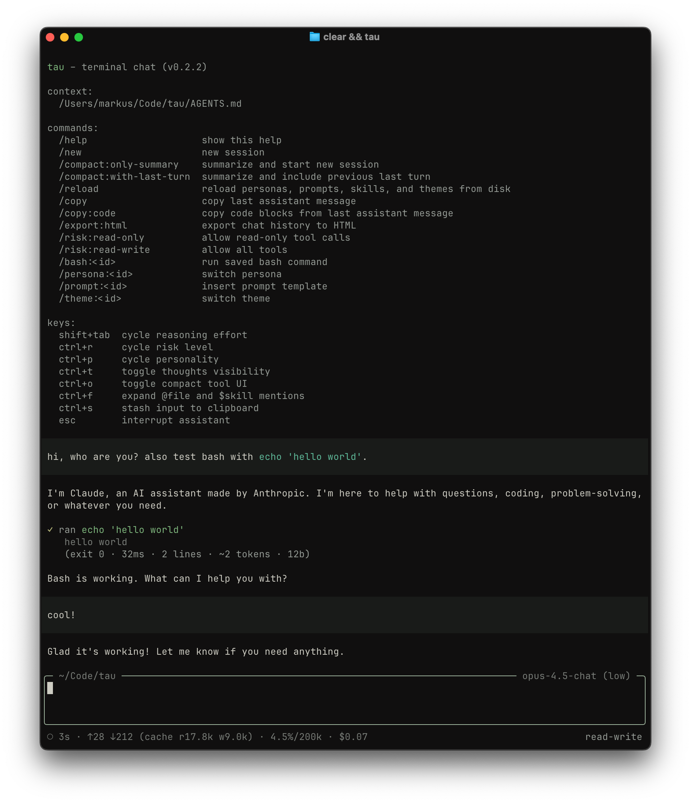

# tau

Tau is an AI agent that works in your projects from the terminal. You describe a task, and the agent reads and edits files, runs commands, and reports back. It works with Anthropic, OpenAI, and Google models, or with a ChatGPT subscription.



## How it fits together

A session has three parts: the client you interact with, the host that runs the conversation and calls the model, and the machine the agent works on. Usually all three are your own computer. They can also be separate, so a session can run on a server or a cloud sandbox while you attach to it from your laptop, a Telegram chat, or your own program. Sessions are saved as you go and continue after a restart. [How Tau works](docs/how-tau-works.md) explains this in more detail.

## What it can do

- **Work in a project.** The agent runs shell commands, edits files, searches the web, and can combine these in small programs that do many steps in one call. You can connect [MCP servers](docs/mcp.md) and add your own tools.
- **Follow your setup.** [Personas](docs/personas.md) choose the model, instructions, reasoning level, and tools. Projects add `AGENTS.md` instructions, prompt templates, and [skills](docs/instructions-and-skills.md).
- **Delegate.** The agent can start [subagents](docs/subagents.md) for parallel work, including Claude Code.
- **Run elsewhere.** `tau serve` and `tau attach` run [remote sessions](docs/remote-sessions.md). The [Telegram runner](docs/telegram.md) gives each chat a session in a project workspace. The [Node SDK](docs/sdk.md) and the [session protocol](docs/session-protocol.md) let you build your own clients.
- **Remember.** Past sessions are [searchable](docs/history.md), locally or through a shared service across machines.

The terminal interface also reviews diffs in the browser and, on macOS, takes dictation and reads answers aloud. Command-line tools cover PDF OCR, image generation, and speech generation.

## Get started

Tau runs on macOS and Linux and needs Node.js 26 or newer.

```sh
npm install -g @markusylisiurunen/tau@latest
export ANTHROPIC_API_KEY='sk-ant-...'
cd ~/Code/my-project
tau
```

[Getting started](docs/getting-started.md) covers other providers, choosing a persona, and preparing your shell. The agent runs commands with your user's permissions, so read [security](docs/security.md) before you give it access to anything sensitive.

## Documentation

The [documentation](docs/index.md) matches the installed version, and the agent can read it too. Once a session is running, you can ask Tau about itself:

```text
Using Tau's documentation, explain how to run a session on a remote server.
```
